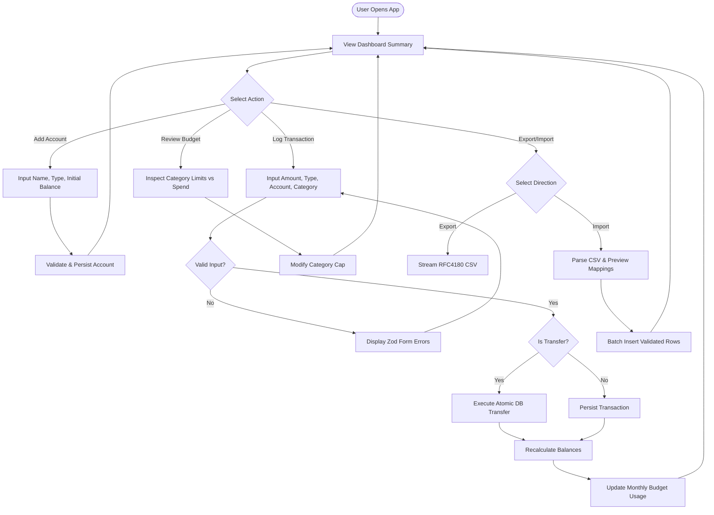

# Personal Finance Tracker — Functional & Technical Specifications

> **DOCUMENT**: `docs/SPEC.md`  
> **STATUS**: BASELINE APPROVED  
> **PHASE**: Phase 0 — Foundation and Documentation

---

## 1. Functional Requirements (FR)

### Module 1: Account Management
- **FR-01 (Account Creation)**: The system shall allow users to create financial accounts with a name, account type (`CHECKING`, `SAVINGS`, `CREDIT_CARD`, `CASH`, `INVESTMENT`), initial balance, and currency (default: USD).
- **FR-02 (Account Editing & Deletion)**: Users may edit account names and types. Accounts with existing transactions cannot be hard-deleted; they may only be archived or soft-deleted to maintain ledger consistency.
- **FR-03 (Balance Recalculation)**: The current balance of any account shall be computed deterministically from its starting balance plus all logged income minus all logged expenses plus net incoming/outgoing transfers.

### Module 2: Transaction Ledger
- **FR-04 (Transaction Entry)**: Users shall log transactions specifying amount, type (`INCOME`, `EXPENSE`, `TRANSFER`), date, account, category, optional merchant/payee, notes, and tags.
- **FR-05 (Inter-Account Transfers)**: When a transfer is recorded, the system shall atomically debit the source account and credit the destination account using a unified transaction pair or linked record.
- **FR-06 (Filtering & Search)**: Users shall be able to filter transactions by date range, account, category, transaction type, and search free-text across payee and notes.
- **FR-07 (Pagination)**: Transactions shall support performant server-side pagination (cursor-based or offset) with page size options (e.g., 25, 50, 100).

### Module 3: Categories & Tagging
- **FR-08 (Default & Custom Categories)**: The application shall seed standard default categories (e.g., Housing, Groceries, Transportation, Utilities, Entertainment, Salary) and allow users to create, edit, and color-code custom categories.
- **FR-09 (Category Assignment)**: Every expense or income transaction must be assigned exactly one primary category.
- **FR-10 (Tags)**: Transactions may have zero or more alphanumeric tags (e.g., `#vacation`, `#tax-deductible`).

### Module 4: Budgets
- **FR-11 (Monthly Budgets)**: Users can set a target expenditure limit for any expense category for a specified calendar month.
- **FR-12 (Budget Progress & Alerts)**: The system shall calculate actual spending versus budget limit and display visual thresholds (Normal <80%, Warning 80-99%, Exceeded ≥100%).
- **FR-13 (Overall Monthly Cap)**: Users may set an overall aggregate monthly spending ceiling.

### Module 5: Analytics & Visualizations
- **FR-14 (Spending Breakdown)**: Interactive donut/pie chart depicting expenditure distribution by category for any chosen month or custom time range.
- **FR-15 (Cash Flow Trend)**: Grouped bar chart comparing total Income vs. total Expenses month-over-month.
- **FR-16 (Net Worth Trajectory)**: Area/line chart plotting net worth over time (Total Assets − Total Liabilities).
- **FR-17 (Summary Metrics)**: High-level metric cards showing Total Income, Total Expenses, Net Savings, and Savings Rate percentage for the selected period.

### Module 6: Data Portability & Import/Export
- **FR-18 (CSV Export)**: Users can export their entire transaction ledger or filtered subset to standard RFC 4180 compliant CSV format.
- **FR-19 (CSV Import)**: Users can upload bank CSV statements, map columns (Date, Amount, Payee, Category), preview mapped rows, and import transactions in batch with deduplication detection.
- **FR-20 (JSON Backup & Restore)**: Full database export and import in JSON format for local disaster recovery and portability.

---

## 2. Non-Functional Requirements (NFR)

### Performance & Responsiveness
- **NFR-01 (API Latency)**: 95th percentile (P95) API response time for transactional CRUD operations must be under 150ms on local SQLite and under 250ms on PostgreSQL.
- **NFR-02 (Frontend Performance)**: Largest Contentful Paint (LCP) < 1.2s; First Input Delay (FID) < 100ms; Cumulative Layout Shift (CLS) < 0.05.
- **NFR-03 (Scalability)**: Ledger queries and aggregate reports must execute efficiently for datasets exceeding 50,000 transactions without blocking the event loop.

### Reliability & Data Integrity
- **NFR-04 (ACID Transactions)**: All balance-altering operations and multi-account transfers must execute within strict database transactions. Partial failures must roll back completely.
- **NFR-05 (Financial Precision)**: Monetary values must NEVER use floating-point numbers. All monetary quantities must be stored and computed as integer minor units (e.g., cents: $10.50 = `1050`) or high-precision decimal objects (`Prisma.Decimal`).

### Security & Privacy
- **NFR-06 (Input Sanitization & Validation)**: Every incoming payload must be validated via strict Zod schemas. Any unknown or malformed fields must be rejected with 422 Unprocessable Entity.
- **NFR-07 (Data Isolation)**: Future multi-tenant queries must enforce mandatory user ownership clauses (`where: { userId }`).
- **NFR-08 (Zero External Leakage)**: Financial data must never be sent to third-party tracking scripts, analytics SDKs, or unvetted external services.

### Accessibility & Compatibility
- **NFR-09 (Accessibility)**: Full compliance with WCAG 2.1 AA standards, including keyboard navigability, high color contrast, screen reader labels, and focus rings.
- **NFR-10 (Cross-Browser Compatibility)**: Fully functional on modern Chromium (Chrome/Edge), Gecko (Firefox), and WebKit (Safari) engines.

---

## 3. Scope Definition

### MVP Scope (Phases 1 through 7)
- Single-user local experience utilizing SQLite (`file:./dev.db`).
- Full account lifecycle (Checking, Savings, Credit, Cash, Investment).
- Full transaction ledger (Income, Expense, Transfer) with Category & Tag support.
- Monthly category budgeting with visual progress indicators.
- Interactive Recharts dashboards (Cash flow, Category breakdown, Net worth).
- Standard CSV export and basic CSV bank statement import.
- Responsive mobile & desktop UI with light/dark theme toggle.
- Comprehensive unit, integration, and E2E test suites.

### Future Scope (Phase 9+ & Post-Release)
- Multi-user authentication (NextAuth.js / Auth.js) with role-based access control.
- PostgreSQL cloud deployment (Supabase, Neon, AWS RDS) with PgBouncer connection pooling.
- Multi-currency support with dynamic foreign exchange rate conversion.
- Automated bank feed aggregation via Open Banking / Plaid / Nordigen APIs.
- AI-driven receipt OCR and automatic transaction classification.
- Split transactions across multiple expense categories.
- Progressive Web App (PWA) with offline-first synchronization.

---

## 4. End-to-End User Workflows

---

## 5. Business Rules & Financial Invariants

1. **BR-01 (Monetary Invariant)**: Transaction amounts must always be strictly positive numbers (`amount > 0`). Directionality is determined solely by the `type` field (`INCOME`, `EXPENSE`, `TRANSFER`).
2. **BR-02 (Transfer Balance Conservation)**: An internal transfer of \$X from Account A to Account B must decrement Account A by exactly \$X and increment Account B by exactly \$X. No money may be created or destroyed during an internal transfer.
3. **BR-03 (Account Deletion Protection)**: An account cannot be deleted if transactions reference it. It must be marked `isArchived = true`, removing it from active pickers while preserving historical reports.
4. **BR-04 (Budget Period Bounds)**: A budget entry applies strictly to a calendar month (e.g., `2026-11-01` to `2026-11-30`). Transactions occurring outside this range do not consume this budget allotment.
5. **BR-05 (Negative Balances)**: Credit cards and lines of credit naturally carry negative balances (representing debt liabilities). Asset accounts (Checking, Savings, Cash) trigger a soft UI warning if balance drops below zero, but operations are not blocked.

---

## 6. Acceptance Criteria (Given-When-Then)

### AC-01: Log an Expense Transaction
- **Given** an active Checking Account with a balance of \$1,000.00
- **When** the user logs an Expense of \$50.00 in category "Groceries" on today's date
- **Then** the transaction is persisted in the ledger, the Checking Account balance displays \$950.00, and the "Groceries" monthly budget consumed amount increases by \$50.00.

### AC-02: Record an Atomic Account Transfer
- **Given** Account A has \$500.00 and Account B has \$200.00
- **When** the user records a Transfer of \$150.00 from Account A to Account B
- **Then** both account balances are updated simultaneously within a database transaction; Account A reflects \$350.00 and Account B reflects \$350.00. If any part of the database write fails, neither balance changes.

### AC-03: Budget Exceeded Visual Warning
- **Given** a "Dining Out" category budget of \$200.00 for the current month with \$180.00 spent
- **When** the user logs an Expense of \$30.00 in "Dining Out"
- **Then** the total spent updates to \$210.00 (105%), the progress bar shifts to the danger/alert state (red), and an exceeded indicator is displayed.

### AC-04: Export Filtered Transactions to CSV
- **Given** a user has 150 transactions across 2026
- **When** the user filters for "October 2026" and clicks "Export CSV"
- **Then** a valid CSV file is downloaded containing only the October transactions with columns: `Date`, `Account`, `Type`, `Category`, `Payee`, `Amount`, `Notes`, `Tags`.
