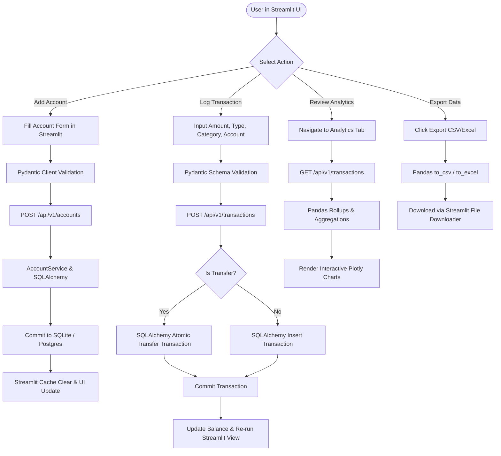

# Personal Finance Tracker — Functional & Technical Specifications

> **DOCUMENT**: `docs/SPEC.md`  
> **STATUS**: BASELINE APPROVED  
> **STACK**: Python (FastAPI, Streamlit, SQLAlchemy, Alembic, Pydantic, Pandas, Plotly)  
> **PHASE**: Phase 0 — Foundation and Documentation

---

## 1. Functional Requirements (FR)

### Module 1: Account Management
- **FR-01 (Account Creation)**: The system shall allow users to create financial accounts with a name, account type (`CHECKING`, `SAVINGS`, `CREDIT_CARD`, `CASH`, `INVESTMENT`, `LOAN`), initial balance (as `Decimal`), and currency (default: `USD`).
- **FR-02 (Account Modification & Archive)**: Users may edit account names, types, and descriptions. Accounts linked to existing transactions cannot be hard-deleted; they may only be archived (`is_archived = True`) to preserve historical integrity.
- **FR-03 (Deterministic Balance Recalculation)**: Current account balance shall be computed deterministically:
  $$\text{Balance} = \text{Initial Balance} + \sum \text{Income} - \sum \text{Expense} + \sum \text{Net Transfers}$$

### Module 2: Transaction Ledger
- **FR-04 (Transaction Entry)**: Users shall log transactions specifying amount (`Decimal > 0`), transaction type (`INCOME`, `EXPENSE`, `TRANSFER`), transaction date, account ID, category ID, optional payee/merchant, notes, and tags.
- **FR-05 (Inter-Account Transfers)**: When recording an internal transfer, the system shall atomically debit the source account and credit the destination account within a single SQLAlchemy database transaction.
- **FR-06 (Filtering, Sorting & Search)**: Users shall filter transactions by date range, account, category, transaction type, and perform substring search on payee and notes.
- **FR-07 (Pagination)**: The FastAPI backend and SQLAlchemy layer shall provide performant cursor-based or offset pagination with customizable limit options (e.g., 25, 50, 100 rows).

### Module 3: Categories & Tagging
- **FR-08 (Default & Custom Categories)**: The application shall seed standard default categories (e.g., Housing, Groceries, Transportation, Utilities, Entertainment, Salary) and allow users to create and edit custom categories with color codes and icons.
- **FR-09 (Category Assignment)**: Every income and expense transaction must be assigned exactly one valid category.
- **FR-10 (Tags)**: Transactions may contain zero or more alphanumeric tags for multi-dimensional tracking (e.g., `#tax2026`, `#client-acme`).

### Module 4: Budgets & Goal Tracking
- **FR-11 (Monthly Budgets)**: Users can establish target expenditure caps for any expense category for a specified calendar month and year.
- **FR-12 (Threshold Monitoring & Visual Alerts)**: The system calculates actual spending versus budget limit and displays visual indicators in Streamlit:
  - **Normal**: Spend $< 80\%$ (Green)
  - **Warning**: Spend $80\% - 99\%$ (Amber)
  - **Exceeded**: Spend $\ge 100\%$ (Red alert banner)
- **FR-13 (Overall Monthly Cap)**: Users may optionally define an aggregate monthly spending ceiling across all categories.

### Module 5: Analytics & Visualizations (Pandas + Plotly)
- **FR-14 (Category Spending Breakdown)**: Interactive Plotly donut/pie chart displaying expense distribution by category for any selected month or date range.
- **FR-15 (Cash Flow Comparison)**: Grouped Plotly bar chart comparing total Income vs. total Expense month-over-month.
- **FR-16 (Net Worth Trajectory)**: Time-series Plotly area/line chart plotting net worth over time ($\text{Total Assets} - \text{Total Liabilities}$).
- **FR-17 (Summary Metrics Cards)**: Streamlit metric cards presenting Total Income, Total Expenses, Net Savings, and Savings Rate percentage ($\frac{\text{Net Savings}}{\text{Total Income}} \times 100$).

### Module 6: Data Portability & Import/Export
- **FR-18 (CSV/Excel Export)**: Users can export their filtered or full transaction ledger to RFC 4180 compliant CSV or Microsoft Excel (`.xlsx`) generated via Pandas.
- **FR-19 (Bank Statement CSV Import)**: Users can upload bank CSV statements, map columns (Date, Amount, Payee, Description), preview the parsed Pandas DataFrame, and execute batch inserts with duplicate transaction detection.
- **FR-20 (JSON Backup & Restore)**: Export and import complete relational database snapshots in JSON format for disaster recovery and portability.

---

## 2. Non-Functional Requirements (NFR)

### Performance & Responsiveness
- **NFR-01 (API Latency)**: 95th percentile (P95) response time for transactional CRUD operations in FastAPI must be $< 100\text{ ms}$ on local SQLite and $< 200\text{ ms}$ on PostgreSQL.
- **NFR-02 (Dashboard Rendering)**: Streamlit page re-runs and Plotly chart renders must complete in $< 500\text{ ms}$ for datasets containing up to 20,000 transactions.
- **NFR-03 (High Volume Aggregation)**: Pandas aggregation pipelines must process 50,000 transaction records in $< 150\text{ ms}$.

### Reliability & Data Integrity
- **NFR-04 (ACID Invariance)**: All balance-altering transactions and multi-account transfers must execute within strict database transaction contexts (`session.begin()`). Any unhandled error triggers an immediate rollback.
- **NFR-05 (Decimal-Safe Monetary Precision)**: Monetary values must NEVER use floating-point types (`float`). All monetary amounts are handled using Python's `decimal.Decimal` and stored as `Numeric(18, 2)` or integer minor units (cents).

### Security & Privacy
- **NFR-06 (Pydantic Input Sanitization)**: Every request payload must be strictly validated by Pydantic models. Malformed, negative amounts (where forbidden), or extraneous fields are rejected with HTTP 422.
- **NFR-07 (Multi-User Data Isolation)**: Every SQLAlchemy query must strictly enforce the tenant ownership clause (`where(Model.user_id == current_user.id)`).
- **NFR-08 (Zero External Leakage)**: The system shall not transmit personal financial data to external analytics, advertising SDKs, or unapproved third-party cloud services.

### Portability & Maintainability
- **NFR-09 (Database Engine Portability)**: Zero engine lock-in. Migrating from SQLite to PostgreSQL must require only updating `DATABASE_URL` and applying Alembic migrations.
- **NFR-10 (Clean Architecture & Testability)**: Separation of concerns between Streamlit UI, FastAPI endpoints, Domain Services, and SQLAlchemy Repositories.

---

## 3. Scope Definition

### MVP Scope (Phases 1 through 7)
- Local single-user mode running on embedded SQLite (`data/finance.db`).
- Full Account management (Checking, Savings, Credit, Cash, Investment, Loan).
- Transaction ledger (Income, Expense, Transfer) with Category and Tag support.
- Monthly category budgeting with visual utilization bars.
- Interactive Plotly visualizations (Cash flow, Category breakdown, Net worth).
- Standard CSV/Excel export and basic bank statement CSV import via Pandas.
- Fully typed FastAPI REST API and responsive Streamlit UI.
- Comprehensive Pytest unit and integration test suites.

### Future Scope (Phase 9+ & Post-Release)
- Multi-user authentication (JWT with OAuth2 password bearer / Auth0).
- Production deployment on cloud PostgreSQL (RDS, Neon, Supabase) with connection pooling.
- Multi-currency support with automated exchange rate conversion.
- Automated bank feed aggregation via Open Banking APIs (Plaid / Nordigen).
- Optional AI receipt scanning (OCR) and predictive transaction categorization (strictly with explicit user consent).
- Containerized deployment using Docker and Docker Compose.

---

## 4. End-to-End User Workflows

---

## 5. Business Rules & Financial Invariants

1. **BR-01 (Strict Positive Amounts)**: All transaction amounts must be strictly positive (`Decimal > 0`). Transaction direction is determined exclusively by the `type` attribute (`INCOME`, `EXPENSE`, `TRANSFER`).
2. **BR-02 (Transfer Balance Conservation)**: For any internal transfer of amount $\$X$ from Account A to Account B:
   - Account A is decremented by exactly $\$X$.
   - Account B is incremented by exactly $\$X$.
   - Net system balance change is exactly $\$0.00$.
3. **BR-03 (Account Deletion Safety)**: An account containing active transactions cannot be deleted. Users must archive the account (`is_archived = True`), hiding it from active form pickers while preserving historical balance audits.
4. **BR-04 (Calendar Month Boundaries)**: Budget limits are bounded to the calendar month (e.g., `2026-11-01` to `2026-11-30`). Transactions outside this range do not consume this budget allotment.
5. **BR-05 (Negative Balances)**: Credit cards and loan accounts carry negative balances representing liabilities. Asset accounts (Checking, Savings, Cash) trigger a soft Streamlit UI warning when balance drops below zero, but operations are not blocked.

---

## 6. Acceptance Criteria (Given-When-Then)

### AC-01: Log an Expense Transaction
- **Given** an active Checking Account with a balance of \$1,000.00
- **When** the user logs an Expense of \$50.00 under "Groceries" on today's date
- **Then** the transaction is persisted in the database, the Checking Account balance displays \$950.00, and the "Groceries" monthly budget consumed amount increases by \$50.00.

### AC-02: Record an Atomic Account Transfer
- **Given** Account A has \$500.00 and Account B has \$200.00
- **When** the user records a Transfer of \$150.00 from Account A to Account B
- **Then** both balances update simultaneously in an atomic SQLAlchemy transaction; Account A reflects \$350.00 and Account B reflects \$350.00. If an error occurs midway, neither balance changes.

### AC-03: Budget Utilization Visual Indicator
- **Given** a "Dining Out" category budget of \$200.00 for the current month with \$180.00 already spent
- **When** the user logs an Expense of \$30.00 under "Dining Out"
- **Then** the total spent updates to \$210.00 (105%), the progress bar switches to Crimson (alert state), and an "Over Budget" notification banner is rendered.

### AC-04: Export Filtered Transactions to CSV
- **Given** a user has 150 transactions recorded in 2026
- **When** the user filters for "October 2026" and clicks "Export to CSV"
- **Then** a valid RFC 4180 CSV file is downloaded containing the October transactions with columns: `Date`, `Account`, `Type`, `Category`, `Payee`, `Amount`, `Notes`, `Tags`.
